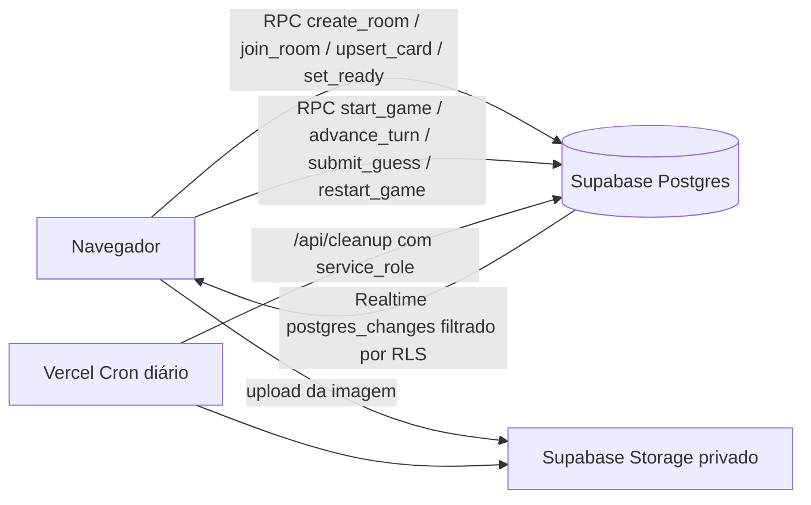

# Quem Sou Eu?

Jogo online multiplayer inspirado no clássico "Quem sou eu?": cada jogador envia uma imagem com uma resposta secreta, o jogo distribui as cartas e cada um vê a carta de todos, menos a própria. Na sua vez, você faz uma pergunta (no Discord ou onde preferir) e passa a vez, ou arrisca um palpite pelo site. Errar passa a vez automaticamente; acertar tira você da fila e marca sua posição no ranking.

## Stack

- Next.js 16 (App Router) + TypeScript + Tailwind CSS 4, hospedado na Vercel (plano Hobby).
- Supabase (plano Free): Postgres + RLS, Auth anônimo, Storage privado e Realtime.
- Toda a regra de jogo roda em funções SQL transacionais; o navegador só chama RPCs e lê o que o RLS permite.

## Como funciona



- Cada pessoa entra com uma sessão anônima do Supabase Auth (opcionalmente protegida por Cloudflare Turnstile).
- A sala tem um código de 6 caracteres (`/sala/ABC234`). Quem abre o link escolhe um apelido e entra no lobby.
- No lobby, cada jogador envia imagem + resposta e marca **Pronto**. O anfitrião inicia quando todos estiverem prontos (mínimo 2, máximo 12).
- `start_game` sorteia a ordem de turno e distribui as cartas em anel aleatório: ninguém recebe a própria carta.
- O RLS impede que o jogador leia a carta (título e imagem) atribuída a ele até acertar. Isso vale para consultas, Realtime e URLs assinadas do Storage.
- Cada turno tem uma versão. `advance_turn` e `submit_guess` exigem a versão atual e o jogador da vez, então cliques duplos ou ações simultâneas só valem uma vez.
- Palpites são comparados no banco ignorando maiúsculas, acentos, espaços e pontuação. O cliente só recebe `correct: true/false`.
- Quando sobra um único jogador adivinhando, ele fecha o ranking e a partida termina. O anfitrião pode iniciar uma nova rodada (todos reenviam cartas).
- Salas expiram 24 horas após a última partida; o cron diário apaga as salas expiradas e as imagens.

## Requisitos

- Node.js 20 ou superior (testado com 22).
- Conta gratuita no [Supabase](https://supabase.com) e na [Vercel](https://vercel.com).

## Configurar o Supabase

1. Crie um projeto no Supabase (região mais próxima de vocês).
2. Em **SQL Editor**, cole e execute o conteúdo de `supabase/migrations/0001_init.sql`. Ele cria as tabelas, as políticas de RLS, o bucket privado `cards`, as funções RPC e adiciona as tabelas ao Realtime.
   - Alternativa com CLI: `npx supabase link --project-ref SEU_REF` e `npx supabase db push`.
3. Em **Authentication > Sign In / Providers**, habilite **Anonymous sign-ins**.
4. (Recomendado para produção) Em **Authentication > Bot and Abuse Protection**, habilite CAPTCHA com **Cloudflare Turnstile** e informe a secret key. Depois defina `NEXT_PUBLIC_TURNSTILE_SITE_KEY` no app. Sem isso, qualquer pessoa pode criar sessões anônimas no seu projeto (há rate limit por IP, mas o CAPTCHA é a proteção principal).
5. Em **Project Settings > API**, copie a URL do projeto, a chave `anon` e a chave `service_role`.

## Rodar localmente

```bash
cp .env.example .env.local   # preencha as variáveis
npm install
npm run dev
```

Abra http://localhost:3000 em duas ou mais janelas anônimas/navegadores diferentes (cada perfil do navegador vira um jogador).

## Deploy na Vercel

1. Suba o repositório no GitHub e importe na Vercel.
2. Em **Environment Variables**, adicione:
   - `NEXT_PUBLIC_SUPABASE_URL`
   - `NEXT_PUBLIC_SUPABASE_ANON_KEY`
   - `SUPABASE_SERVICE_ROLE_KEY` (apenas servidor; usada pela rota `/api/cleanup`)
   - `CRON_SECRET` (valor aleatório longo; a Vercel envia esse valor no header `Authorization` do cron)
   - `NEXT_PUBLIC_TURNSTILE_SITE_KEY` (opcional)
3. Faça o deploy. O `vercel.json` registra um cron diário (`0 4 * * *`) em `/api/cleanup`, que é o máximo de frequência permitido no plano Hobby.

Para limpar manualmente: `curl -H "Authorization: Bearer $CRON_SECRET" https://SEU-APP.vercel.app/api/cleanup`.

## Scripts

```bash
npm run dev               # servidor de desenvolvimento
npm run build             # build de produção
npm run lint              # ESLint
npm test                  # unitários + integração
npm run test:unit         # regras puras (normalização, turnos, validação)
npm run test:integration  # migração real em um Postgres embutido: RLS, RPCs e concorrência
```

Os testes de integração sobem um Postgres local via `embedded-postgres` (sem Docker), aplicam `tests/integration/supabase-shim.sql` (papéis `authenticated`/`service_role`, `auth.uid()`, `storage.objects`) e depois a migração real. Cada cenário roda como um usuário autenticado diferente, então as políticas de RLS são exercitadas de verdade.

## Estrutura

```
src/
  app/                      # home, /sala/[codigo], /api/cleanup
  components/
    game/                   # lobby, tabuleiro, controles de turno, ranking, feed
    ui/                     # botões, campos, alertas
    Turnstile.tsx           # widget do CAPTCHA
  lib/
    game/                   # regras puras, tipos, validação, chamadas RPC, imagem
    hooks/                  # useSession (auth anônimo), useRoom (snapshot + realtime)
    supabase/               # clientes browser e admin
supabase/migrations/        # schema, RLS, Storage e funções SQL
tests/unit/                 # vitest
tests/integration/          # Postgres embutido + migração real
```

## Limites do plano gratuito (outubro de 2026)

| Recurso | Free / Hobby | Impacto no jogo |
| --- | --- | --- |
| Supabase Realtime | 200 conexões simultâneas, 2 milhões de mensagens/mês | Cada jogador usa 1 conexão; uma partida gera algumas dezenas de mensagens. Folga enorme para uso entre amigos. |
| Supabase Storage | 1 GB de arquivos, 5 GB de egresso/mês | Imagens são reduzidas a ~1024px JPEG (100 a 300 KB). O cron apaga salas antigas. Este é o limite mais sensível se houver muitas partidas por mês. |
| Supabase Database | 500 MB, pausa após 1 semana sem uso | O banco é minúsculo. Se o projeto pausar, basta reativar no painel antes de jogar. |
| Supabase Auth anônimo | 30 logins anônimos/hora por IP | Suficiente; cada navegador faz 1 login e reutiliza a sessão. |
| Vercel Hobby | 1 milhão de invocações, cron diário | O app é quase todo estático + chamadas diretas ao Supabase; a única função é o cron. |

Se um dia precisar escalar: Supabase Pro remove a pausa e amplia Storage/egresso; a Vercel Pro permite crons mais frequentes.

## Limitações conhecidas

- A sessão anônima vive no navegador. Limpar dados do site ou trocar de dispositivo faz você perder o lugar na sala (precisa entrar de novo; o anfitrião pode te remover no lobby).
- Entrar em uma sala em andamento não é permitido; aguarde o anfitrião voltar ao lobby.
- Não há chat: a conversa e as perguntas acontecem fora do site (Discord).
- Quem recebe sua carta vê quem a enviou (por eliminação isso já seria conhecido no jogo presencial).
